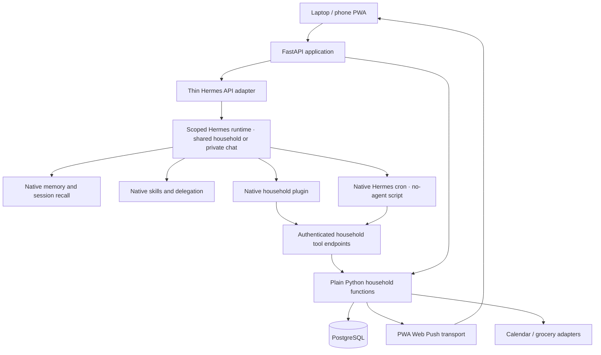

# Architecture

Agreed baseline: 26 October 2026; updated 25 November 2026. This document distinguishes the target boundaries from the smaller [current feasibility build](feasibility.md). Current next steps and operational state are in [development handoff](handoff.md).

## Components

| Component | Owns |
| --- | --- |
| PWA | Currently chat, upcoming tasks and notification permission; target category views support direct household record management alongside agent assistance. |
| Application API | Authentication, access checks, user-visible transcripts, durable request status and household records. |
| Hermes adapter | Translation between application conversations and Hermes requests; stable conversation identifiers and request identities. |
| Hermes | Agent conversation, native sessions and recall, curated memory, skills, scheduling and specialist delegation. |
| Native plugin | Thin wrappers calling authenticated household tools. No duplicate implementation of household rules. |
| Household code | Validation, date calculations, task state transitions and integration-specific business rules. |
| Request worker | Processes saved chat requests; it does not schedule reminders. |
| Hermes cron | Owns scheduled execution. A script-only job invokes the household reminder action every minute with no model call; agent-backed jobs can handle creative reviews. |
| Notification functions | Due-task evaluation, notification outbox and bounded retries, invoked by Hermes cron. PWA push is a custom transport rather than a second scheduler. |
| PostgreSQL | Authoritative household records and application history. |

Required steps must execute in code. An LLM choosing whether to call a deterministic tool
is still a probabilistic decision; a prompt cannot guarantee a required sequence.

Use Hermes' built-in features directly. Portability means keeping our household functions and external integration adapters clean; it does not mean creating custom memory, skill or scheduler systems in anticipation of a future framework.

## Direct UI and agent actions

The 25 November 2026 product direction is an app with built-in agent support. Future Events,
Meals, Shopping and Stock/Supplies screens call household-scoped application APIs directly.
Agent tools call the same domain functions and update the same PostgreSQL records. Validation,
permissions and required state transitions belong in those shared functions, not solely in
prompts or browser code. Routine list and stock edits must work without inference.

Category selection and resumable onboarding progress will be explicit application state.
Hermes remains responsible for native preferences/memory, sessions, skills and scheduling;
structured transactional facts remain in PostgreSQL. Define how profile corrections update
native memory when implementing editable onboarding answers. These are target boundaries;
category APIs, onboarding and inventory records are not yet implemented.

## Agent responsibilities

The intended design is an orchestrator with focused specialists for occasions/gifts,
meals/groceries, appointments/supplies and, later, home tasks. Specialists are invoked when
needed rather than running continuously or requiring separate servers.

The spike supplies one Hermes persona and three native tools: `household_clock`, `household_tasks` and `household_remind`. Native skills for household orchestration, meals and supplies are installed with structured handoff contracts. They are prepared for a proposal-only coordination experiment; live specialist execution, grocery writes and pantry tools are not yet validated or implemented. Keep initial delegation small so its delivery behaviour and cost can be observed.

## Request and notification flows

1. The backend authenticates a browser request, resolves its household and saves the message
   and request identity before processing it.
2. The worker handles an explicit deterministic command or calls the household's Hermes
   runtime. The browser does not receive Hermes API credentials.
3. Hermes can call the native plugin. The tool credential determines the household, and
   backend code validates any requested change before saving it.
4. The application stores the final visible response. Closing the browser does not remove
   pending work; reopening loads its saved history and status.
5. Separately, Hermes cron runs the installed no-agent script every minute. The script authenticates to `/api/tool/dispatch-reminders`; a household-scoped function evaluates due tasks, records in-app reminders and attempts queued pushes. No independent application reminder timer or model call is involved.

Current chat uses polling. Reminder delivery uses a persistent outbox with bounded retries
and expired-subscription handling. Delivery is at least once, with notification tags to
reduce visible duplicates. An accepted push is not proof of lock-screen display.

The browser polls every 2.5 seconds while work is pending and every 30 seconds when idle.
Actions and tab return refresh immediately; hidden tabs stop polling. Reads serialize and
queue a fresh read after concurrent actions or conversation changes. Losing chat access clears
the selected records and immediately loads a permitted conversation at the next refresh.
This does not alter the native reminder schedule or call models.

The adapter checks Hermes' response-body status even on HTTP 200. Failed turns retain reported usage, are saved as failed, and produce a request reference plus a safe error category in application logs. Hermes owns provider-call retries. A versioned compatibility patch adds bounded recovery for rejected encrypted reasoning on the OpenRouter chat-completions path; it preserves visible messages and tool receipts. See [local setup](local-setup.md#diagnosing-chat-failures) for diagnostics and the restart requirement.

## Data and tenancy

The target structured model includes users, households, memberships, conversation participants, people, occasions, preparation tasks, timestamped pantry observations, grocery items, integration connections, workflow runs, notification subscriptions and delivery attempts. Hermes' native curated memory holds stable preferences and routines; its skills hold reusable household procedures. We are not building a parallel general-purpose memory service.

The implementation includes individual identities/recovery, household memberships/roles, account sessions/devices, shared/private conversations with participants, actor-linked runs, tasks, encrypted account-scoped integrations, scoped runtime registrations, leased delivery and per-run/account usage. Five migrations preserve the old schema and enforce ancestry/immutable parent scopes through constraints and triggers. Browser, tool, worker and notification paths share conversation permissions. Model routing checks a separate, labeled, restricted container and state volume per shared household or private conversation. Only local compatibility mode can use the old single-household runtime; hosted mode refuses that fallback. See [phase 2 foundations](phase-2-accounts.md) for evidence and operational rules. Database row-level policies are not implemented; deterministic permissions, ancestry checks and runtime/capability boundaries are the tested controls.

Application queries and tool handlers must check the household boundary. Background jobs,
device subscriptions, credentials and agent context require the same isolation. A valid
conversation ID alone never grants access.

The original personal instance still has one enabled Hermes route and was not migrated by the phase 2 work. The new scoped mode requires a separate restricted container and labeled state volume for each shared household or private conversation, with encrypted API credentials and scope-bound backend capabilities. Native storage, routes, tools and restore scope checks have passed in temporary containers. Real provider quality, operational hosting and phone delivery remain separate checks before a friends pilot; host/Docker administrators remain trusted.

## Persistence and migration boundaries

The application transcript and structured household facts are independent of Hermes'
internal session state. Hermes may preserve tool history and other execution details that
are not directly portable to another framework.

Profile-scoped `USER.md` and `MEMORY.md` are intentionally used for remembered preferences and lessons. They are bounded curated memory, not an inventory or transactional task database. Hermes loads a snapshot at session start, so use a fresh conversation at natural boundaries and native session search for older context. Future migration will include exporting these files, adapting skills and recreating schedules as needed.

The API adapter uses the same household-and-conversation identifier for the Responses `conversation` field and `X-Hermes-Session-Key`. Both must remain stable within a chat and differ between chats. A household-only session header made new app chats resolve to the existing native transcript, preventing a reliable fresh-session memory check. New chats now get distinct native sessions while retaining profile memory in the household's dedicated Hermes home. Existing saved response chains are preserved; this change does not rewrite historical transcripts or create a tenant security boundary.

Keep domain functions and integration contracts free of Hermes imports. A future SDK-based
agent should reuse these functions, the database, application API and PWA. Expect to rewrite
agent definitions, tool registration, context/session integration, delegation and runtime
hooks. Full internal execution-state portability is not promised.

## Railway hosting decision — 26 November 2026

Railway supersedes Render for the personal pilot at the user's approximately US$10/month
budget. A US$10 workspace Compute hard cap is explicitly requested, with shutdown accepted.
The cap is configured/verified in Railway separately from `.railway/railway.ts`. Keep one
awake Web, one private Hermes, and PostgreSQL 17 with persistent data/native state; only Web
receives a public domain. Both app services build GitHub main after repository connection
and initial infrastructure apply. Later app pushes do not automatically apply IaC.
The app can derive its HTTPS origin from Railway's domain or an explicit origin, and uses
Hermes' private hostname. Existing personal-account and private-chat boundaries are preserved.
See [deployment](deployment.md); the Render discussion below is historical alternative context.

## Local development and deployment

The app uses `.venv` and the root lockfile; Hermes uses a separate environment and pinned
upstream revision under `.local/hermes-runtime`. Its private home is `.local/hermes-home`.
Do not mix package environments or alter global Hermes settings for this project.

PostgreSQL runs locally in Docker. The spike has one application process with one embedded
chat-request worker, plus one dedicated Hermes runtime whose cron scheduler owns reminder
timing. Both services must remain running for proactive delivery. Do not scale to multiple
web workers or duplicate schedulers with the current recovery and delivery code.

On 25 November 2026, the user accepted Render for the initial private personal deployment,
superseding the earlier Vercel preference. Use one public FastAPI web service, one private
Hermes service with persistent home storage, and managed PostgreSQL in the same region.
Keep Hermes and database endpoints private. Preserve the existing native memory, sessions,
learned skills and cron job during transfer; update machine-specific paths and credentials
without creating a second scheduler against the live household.

Deploy current functionality first, then build adaptive onboarding and category views.
See [Render deployment](deployment.md) for prerequisites, responsibilities and verification.
This is not a multi-household launch. Account and local Docker-isolation foundations are
implemented. On Render, `HOSTED_MODE=true` requires personal login and a private encryption
key. `PAAS_PERSONAL_RUNTIME=true` explicitly permits only the configured household's shared
chats to use its dedicated private service, with a separate tool credential. Private chats
and other households never fall back to that service. Docker-attested scoped runtime routes
remain available on a host that supports Docker; Render does not provide the web app with
Docker access or equivalent attestation. Do not treat this personal PaaS route as verified
multi-household runtime isolation.
