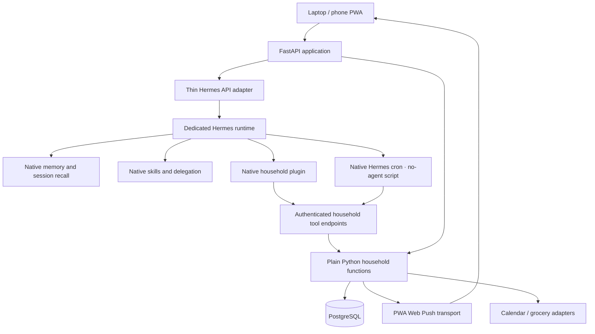

# Architecture

Agreed baseline: 26 October 2026; updated 27 October 2026. This document distinguishes the target boundaries from the smaller [current feasibility build](feasibility.md). Current next steps and operational state are in [development handoff](handoff.md).

## Components

| Component | Owns |
| --- | --- |
| PWA | Conversation display, message submission, upcoming tasks and notification permission. |
| Application API | Authentication, access checks, user-visible transcripts, durable request status and household records. |
| Hermes adapter | Translation between application conversations and Hermes requests; stable conversation identifiers and request identities. |
| Hermes | Agent conversation, native sessions and recall, curated memory, skills, scheduling and specialist delegation. |
| Native plugin | Thin wrappers calling authenticated household tools. No duplicate implementation of household rules. |
| Household code | Validation, date calculations, task state transitions and integration-specific business rules. |
| Request worker | Processes saved chat requests; it does not schedule reminders. |
| Hermes cron | Owns scheduled execution. A script-only job invokes the household reminder action every minute with no model call; agent-backed jobs can handle creative reviews. |
| Notification functions | Due-task evaluation, notification outbox and bounded retries, invoked by Hermes cron. PWA push is a custom transport rather than a second scheduler. |
| PostgreSQL | Authoritative household records and application history. |

Required steps must execute in code. An LLM choosing whether to call a deterministic tool
is still a probabilistic decision; a prompt cannot guarantee a required sequence.

Use Hermes' built-in features directly. Portability means keeping our household functions and external integration adapters clean; it does not mean creating custom memory, skill or scheduler systems in anticipation of a future framework.

## Agent responsibilities

The intended design is an orchestrator with focused specialists for occasions/gifts,
meals/groceries, appointments/supplies and, later, home tasks. Specialists are invoked when
needed rather than running continuously or requiring separate servers.

The spike supplies one Hermes persona and three native tools: `household_clock`, `household_tasks` and `household_remind`. Native skills for household orchestration, meals and supplies are installed with structured handoff contracts. They are prepared for a proposal-only coordination experiment; live specialist execution, grocery writes and pantry tools are not yet validated or implemented. Keep initial delegation small so its delivery behaviour and cost can be observed.

## Request and notification flows

1. The backend authenticates a browser request, resolves its household and saves the message
   and request identity before processing it.
2. The worker handles an explicit deterministic command or calls the household's Hermes
   runtime. The browser does not receive Hermes API credentials.
3. Hermes can call the native plugin. The tool credential determines the household, and
   backend code validates any requested change before saving it.
4. The application stores the final visible response. Closing the browser does not remove
   pending work; reopening loads its saved history and status.
5. Separately, Hermes cron runs the installed no-agent script every minute. The script authenticates to `/api/tool/dispatch-reminders`; a household-scoped function evaluates due tasks, records in-app reminders and attempts queued pushes. No independent application reminder timer or model call is involved.

Current chat uses polling. Reminder delivery uses a persistent outbox with bounded retries
and expired-subscription handling. Delivery is at least once, with notification tags to
reduce visible duplicates. An accepted push is not proof of lock-screen display.

The implemented browser interval is 2.5 seconds while visible, fetching messages and tasks even when idle. The agreed next change is fast polling while work is pending, approximately 30 seconds when idle, immediate refresh after actions/on tab return, and no hidden-tab polling or overlapping requests. This optimization is still pending; it does not alter the native reminder schedule or call models.

The adapter checks Hermes' response-body status even on HTTP 200. Failed turns retain reported usage, are saved as failed, and produce a request reference plus a safe error category in application logs. Hermes owns provider-call retries. A versioned compatibility patch adds bounded recovery for rejected encrypted reasoning on the OpenRouter chat-completions path; it preserves visible messages and tool receipts. See [local setup](local-setup.md#diagnosing-chat-failures) for diagnostics and the restart requirement.

## Data and tenancy

The target structured model includes users, households, memberships, conversation participants, people, occasions, preparation tasks, timestamped pantry observations, grocery items, integration connections, workflow runs, notification subscriptions and delivery attempts. Hermes' native curated memory holds stable preferences and routines; its skills hold reusable household procedures. We are not building a parallel general-purpose memory service.

The spike implements households, access-code sessions, conversations, messages, runs, tasks,
push subscriptions/deliveries and basic AI usage records. SQLAlchemy creates the initial
schema; versioned migrations and database row-level policies remain future work.

Application queries and tool handlers must check the household boundary. Background jobs,
device subscriptions, credentials and agent context require the same isolation. A valid
conversation ID alone never grants access.

Only the personal household has an enabled Hermes route in this spike. Another household
is refused rather than routed into the same profile. Separate profiles/processes are the
initial candidate for future runtime isolation; profile-level memory and tool access must
be validated before inviting friends. The current setup is not a hardened tenant sandbox.

## Persistence and migration boundaries

The application transcript and structured household facts are independent of Hermes'
internal session state. Hermes may preserve tool history and other execution details that
are not directly portable to another framework.

Profile-scoped `USER.md` and `MEMORY.md` are intentionally used for remembered preferences and lessons. They are bounded curated memory, not an inventory or transactional task database. Hermes loads a snapshot at session start, so use a fresh conversation at natural boundaries and native session search for older context. Future migration will include exporting these files, adapting skills and recreating schedules as needed.

Keep domain functions and integration contracts free of Hermes imports. A future SDK-based
agent should reuse these functions, the database, application API and PWA. Expect to rewrite
agent definitions, tool registration, context/session integration, delegation and runtime
hooks. Full internal execution-state portability is not promised.

## Local development and deployment

The app uses `.venv` and the root lockfile; Hermes uses a separate environment and pinned
upstream revision under `.local/hermes-runtime`. Its private home is `.local/hermes-home`.
Do not mix package environments or alter global Hermes settings for this project.

PostgreSQL runs locally in Docker. The spike has one application process with one embedded chat-request worker, plus one dedicated Hermes runtime whose cron scheduler owns reminder timing. Both services must remain running for proactive delivery. It is not safe to scale this topology to multiple workers yet. Later, deploy the application and Hermes runtime with persistent state on a PaaS; the household's Hermes home must also survive redeployment.

Railway is the current hosting suggestion, not an infrastructure commitment. Preserve
container-friendly processes, standard PostgreSQL and configurable providers so the app can
move to another host. Configure backups and test restoration before a hosted friends pilot.
