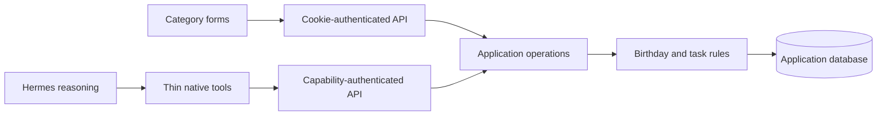

# Category UI and application boundary

Implemented locally 27 November 2026 (Pacific/Honolulu). This is the first Events slice, retaining the existing plain HTML/CSS/JavaScript PWA, database and Hermes runtime. It introduces no migration, scheduler, preference database or framework. No production deployment or paid provider check is part of this change.

## Screen design

Events is the default screen: dated birthdays and gift preparation on the left, upcoming accessible tasks on the right. Phone layouts stack these cards. Both have direct forms, pending feedback and completion/edit actions; no inference is required. Ready/cancelled birthdays stop preparation; purchased birthdays remain open. Cancelled is the supported way to remove an occasion from active work while retaining its history. This slice does not implement hard deletion, recurring occasions, general event CRUD or automatic Calendar import.

The persistent navigation contains Events, Meals, Shopping, Stock & supplies, Assistant and Settings. Desktop uses a sidebar; phones use a compact two-row category menu. Meals, Shopping and Stock lead to explicit planned-capability screens; they do not pretend to have saved records or write APIs. The Assistant keeps the existing transcript, participant controls, draft, request status and polling. Gift ideas opens a draft in the Assistant and does not send it automatically. Settings contains account recovery/rotation, read-only Calendar connections, device notifications and a place for future category setup.

The selected conversation remains the existing privacy scope for birthdays and new reminders. Conversation selection is available in every view, with separate shared/private chat creation. The scope note explains privacy and the household display timezone. Upcoming tasks retain the existing behavior of showing every reminder the authenticated person can access, including their other chats. This preserves private records rather than moving them into a household-wide Events table. A later standalone event sharing model will need an explicit migration and permission design.

The URL retains both conversation and view on reload. Existing notification URLs with only a conversation open the Assistant. Switching category does not create a new conversation or native session. New reminder dates are entered in the explicitly labeled device timezone and sent with a UTC offset; saved task times display in the household timezone. Birthday preparation remains 09:00 in the household timezone across daylight-saving changes.

Failed birthday saves keep the form and birthday UUID; failed reminder submissions keep their request UUID until the content or conversation changes. Submit buttons are disabled during saves. Empty Events and upcoming lists give a direct next step. Provider downtime does not disable these forms.

## Implemented operation contract

`application.HouseholdOperations` accepts a server-created `Principal` and validated input models. Browser cookies or runtime bearer capabilities resolve that principal in the HTTP adapter; a model never supplies a household, actor, role or runtime binding. A private runtime's capability binds its conversation even when its owner can access other conversations. The application checks conversation access and bound runtime scope before writes and filters reads. HTTP authentication rechecks active membership/runtime ownership on each request.

| Operation | Input | Result and persistence |
| --- | --- | --- |
| `birthdays` | Principal | Accessible dated records, optionally restricted to the capability's conversation. |
| `save_birthday` | Principal, birthday UUID, `BirthdayInput` | Saved record and stable preparation task ID. Owns the transaction and calls birthday validation/reconciliation. Repeat saves reuse the record/task; moving between conversations is rejected. |
| `tasks` | Principal | Accessible tasks with due date, state and delivery receipts. |
| `remind` | Principal, `ReminderInput` | Task ID, conversation ID, title and UTC due date. Saves the completed run and visible receipt atomically. Household/request UUID is the retry identity; changed input or an explicitly different chat conflicts. |
| `complete_task` | Principal, task UUID | `{ok: true}` after permission checks and a transaction. The domain transition also marks linked birthday preparation ready. Repeating completion is safe. |

`ApplicationError` carries a sanitized status/detail and has no FastAPI dependency. The HTTP adapter maps it to the existing `{detail: string}` response: 404 hides missing/inaccessible records, 422 represents invalid dates/fields/transitions, and 409 signals conflicting request identity or concurrent saves. Authentication remains 401/403; schema validation remains Pydantic 422. Database constraints remain the final ancestry/uniqueness guard. Browser APIs and `/api/tool/` adapters invoke these operations directly, rather than calling another HTTP handler.

The native plugin remains standard-library-only HTTP wrappers. `household_complete_task` joins the existing clock, task, reminder and birthday tools; it must be called only when the user confirms the work is finished. Tools receive application results and must confirm a saved ID/success receipt before claiming an action succeeded. Runtime configuration, not model arguments, determines the backend origin and credentials.

Existing `agents.py` continues to own request/session translation, runtime routing and provider response parsing. Its deterministic `/remind` compatibility path continues to call the same low-level reminder rule; leased worker completion remains unchanged. The new service is the shared boundary for category/tool operations, not a claim that every account, integration or delivery operation has been moved out of `app.py`. Those existing flows remain separately scoped. Hermes still owns native memory, session recall, skills, delegation and the single no-agent cron tick. Due evaluation/outbox/push remain application code invoked by that tick.

## Preference and correction ownership

| Information | Authority | Correction path |
| --- | --- | --- |
| Birthday date, budget, progress, preparation lead time and notes for this dated occasion | Application birthday record | Direct save or authorized tool save. Tools must reread the record before using its fields. Occasion notes are not a general recipient preference profile. |
| General tastes, favourite foods, routines and gift interests learned in conversation | Hermes native curated memory | Explicit correction through the Assistant using native memory; no app-side preference mirror is created. Existing native memory is not edited or erased by this change. |
| Category selection, onboarding progress and explicit operational settings | Future structured app settings | Future direct settings API will validate and save them. Inject current settings into each agent request as authoritative structured context; do not also save them into native curated memory. |
| Usual staples | Native preference until a dedicated editable setting is designed | Never infer current stock from it. Actual stock requires a timestamped application observation. |

Future editable onboarding must label which answers are structured settings and which are native-memory preferences. A native-memory edit needs a scoped native read/write with an acknowledged receipt; on failure show pending/failed and retain the old value, rather than claiming success. Until that support exists, the UI must route preference corrections through the Assistant instead of storing another authoritative copy. Existing duplicate native memories about application-owned fields must be treated as historical context; fresh application reads take precedence. Current tools already instruct the agent to read saved birthday fields before suggesting changes.

## Proposals and acceptance

Gift/meal suggestions and specialist results remain chat proposals. They do not create meal plans, shopping items or stock observations. An explicit authorized birthday save is an accepted record operation today. Changing progress requires a validated save/completion operation, never a change inferred only from a suggestion.

Before Meals or Shopping gets write tools, implement an explicit `accept_meal_plan` application operation: take the chosen proposal content, selected dates/servings and a stable acceptance request UUID; validate scope, quantities and dates; atomically persist the accepted plan and any explicitly approved shopping additions; return saved IDs. Both an “Accept plan” button and an authorized agent action must use it. Replaying the same acceptance must not duplicate records. No such storage, acceptance endpoint or grocery integration is implemented in this slice.

## Verification

Automated checks exercise direct UI/tool parity, shared validation, birthday/reminder retry identities, scope enforcement without HTTP, and private-runtime read/write/completion denial across chats. Existing adapter tests retain distinct conversation/session keys and stable request identities using mocked provider responses; they do not prove live model tool selection.

The isolated browser fixture runs with AI disabled on desktop and phone viewport sizes. It covers birthday creation/edit/completion/reload, failed-save draft retention/retry, direct reminder creation/completion, category navigation and chat draft retention. Screenshots contain synthetic data only in `.local/screenshots/categories/`. Separate browser checks cover adaptive polling and account/private-chat sharing/revocation. Real iPhone touch/notification delivery and hosted deployment remain separate checks.
